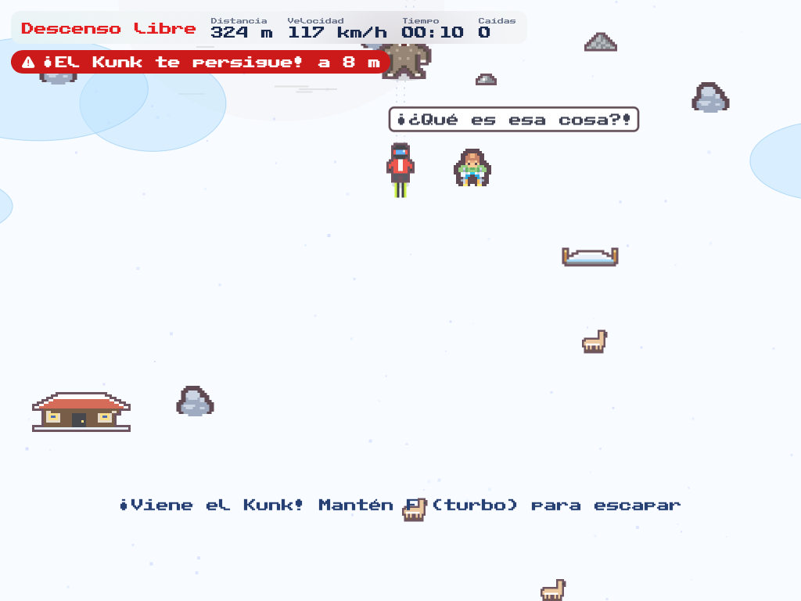
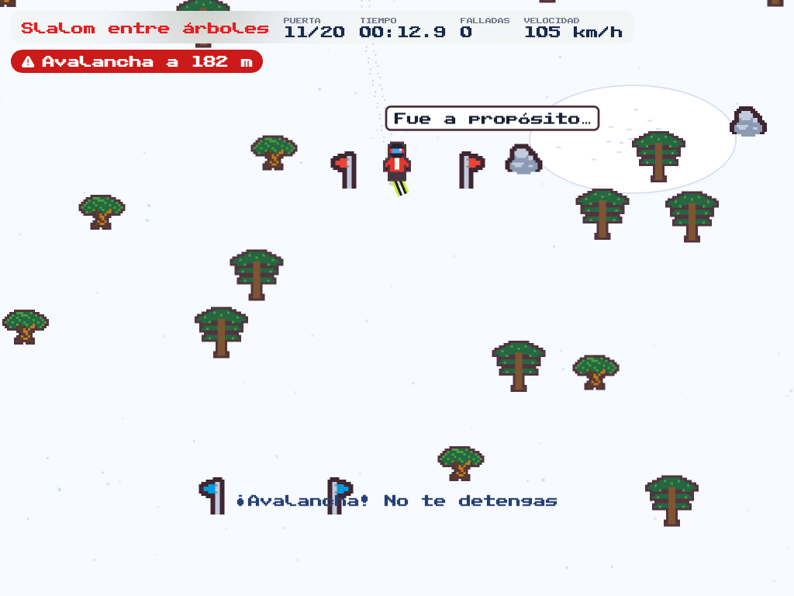
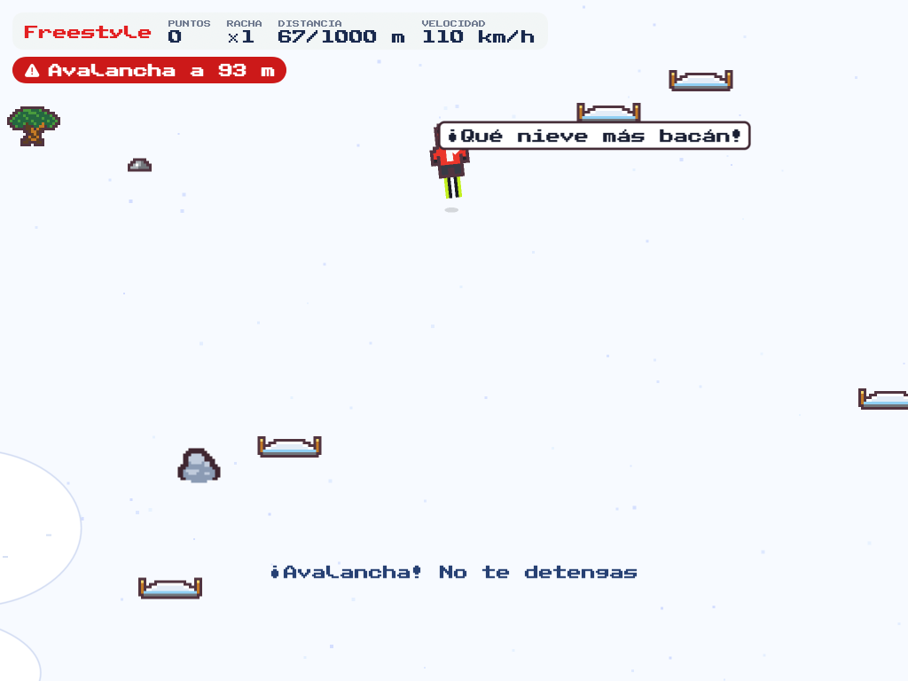

# SkiFlow

Juego de esquí 2D para macOS inspirado en el clásico *SkiFree* (1991), ambientado en la **cordillera de los Andes**. Eres **el Cuico**, un típico chileno que sube a la nieve más a posar que a esquiar. Baja la montaña esquivando queñuas, rocas, llamas y otros esquiadores, compite contra el reloj en slalom, haz acrobacias en freestyle… y huye del **Kunk**. Y si tienes muy mala suerte, también del **Chupacabras**.

<p align="center">
  
  
  
</p>

> Versión **1.0.0**. Historial en [CHANGELOG.md](CHANGELOG.md) y plan de desarrollo en [TODO.md](TODO.md).

## Descargar e instalar

1. Descarga el último `SkiFlow-<versión>.dmg` de la página **Releases** del repositorio.
2. Ábrelo y arrastra **SkiFlow** a la carpeta **Aplicaciones**.
3. La primera vez, macOS no te dejará abrirlo porque no está notarizado: sigue los pasos de [Abrir la app por primera vez](#abrir-la-app-por-primera-vez).

Requiere **macOS 26 o superior**. Es gratis y no necesita cuenta.

## Controles

| Teclado | Ratón / trackpad | Mando | Acción |
|---|---|---|---|
| ← / A, → / D | Mover el cursor | Stick izquierdo o cruceta | Girar (mantén la tecla para seguir girando) |
| ↓ / S | Cursor bajo el Cuico | Cruceta ↓ | Apuntar recto hacia abajo |
| ↑ / W | Cursor por encima | Cruceta ↑ o B (○) | Frenar (esquís atravesados) |
| ← / → con los esquís atravesados y parado | | Cruceta ← / → | Caminar de lado, paso a paso, para colocarte |
| Espacio | Clic | A (✕) | Brincar |
| F (mantener) | | X (□) o gatillo derecho | Turbo |
| Esc / P | | Menú (Options) | Pausa |
| R | | Vista (Share) | Reiniciar (montaña nueva en Descenso libre; mismo trazado en slalom) |
| 1 / 2 / 3 / 4 | | | Descenso libre / Slalom / Slalom entre árboles / Freestyle |

Al tocar las teclas de giro se desactiva el apuntado con ratón; vuelve a activarse en cuanto mueves el ratón. La partida se pausa sola si cambias de app.

Las teclas se pueden reasignar en **Ajustes › Controles** (⌘,). En **Ajustes › General** hay opciones de accesibilidad: reducir movimiento y HUD de alto contraste. Con mando también se manejan los menús (cruceta para elegir, A para empezar, B para volver). Atajos del menú **Juego**: ⌘N nueva bajada, ⌘P pausa, ⌘R reiniciar, ⌘1–⌘4 elegir modo, ⇧⌘M menú principal y ⌘F pantalla completa.

En **Récords** (menú principal) ves tu top 10 de cada modo y tus estadísticas; el botón **Repetir** vuelve a bajar la misma montaña de una marca. Los récords se guardan en el Mac con SwiftData.

En el menú principal puedes escribir una **semilla** (un número) para repetir una montaña concreta; la de la partida en curso aparece en el menú de pausa.

## En la montaña

- **Alta montaña**: rocas, penitentes de hielo y apachetas. Más abajo aparecen cactus, y al final el bosque de araucarias y queñuas.
- **Fauna**: zorros culpeos (frecuentes y rápidos) y pumas (raros, lentos y grandes). Las llamas, guanacos y vicuñas casi nunca se ven en la nieve.
- **Rampas**: saltas sobre lo que sea bajo (rocas, animales…), pero no sobre árboles, refugios ni torres. ¡Ojo con los cóndores en pleno vuelo!
- **Hielo**: cuesta frenar. **Nieve profunda**: frena. **Viento blanco**: te empuja de lado y tapa la vista.
- Las piedras pequeñas te hacen tropezar; todo lo demás te tira al suelo.

## Modos

- **Descenso libre**: baja lo más lejos posible. A partir de los 2.000 m te persigue el Kunk.
- **Slalom**: 20 puertas en una pista abierta. Pasa entre las dos banderas de cada puerta; cada puerta fallada suma 5 s. R repite el mismo trazado para mejorar tu tiempo.
- **Slalom entre árboles**: lo mismo, pero en un bosque cerrado de araucarias y queñuas.
- **Freestyle**: 1.000 m llenos de rampas para sumar puntos con trucos (ver abajo).
- En los slalom y en freestyle no hay criaturas, pero sí una **avalancha** que baja detrás de ti: si te paras o te caes demasiado, te sepulta.

### Trucos (Freestyle, en el aire)

| Tecla / botón | Truco | Puntos |
|---|---|---|
| ← / → | Giro 360 | 100 |
| ↓ | Mortal adelante | 150 |
| ↑ | Mortal atrás | 150 |
| Espacio (A en el mando) | Selfie | 50 |

Varios trucos en el mismo salto multiplican los puntos, y cada aterrizaje limpio sube la racha (hasta ×4). Si terminas el truco justo al tocar el suelo o aterrizas atravesado, solo te llevas la mitad y se corta la racha. Si tocas el suelo a mitad de un truco, te caes y pierdes los puntos del salto.

## El Cuico

Un típico chileno que sube a la nieve más a posar que a esquiar: casco negro, antiparras espejadas, parka roja de marca y esquís con cantos verde lima. Comenta lo que le pasa («¡Pucha, mi parka nueva!») y, si se queda quieto, saca el teléfono para una foto con la cordillera.

> Descripción y frases provisionales: la personalidad definitiva la afina App-Zilla.

## Los rivales

En Descenso libre y Freestyle se cruzan esquiadores de los países vecinos. Bajan haciendo eses, comentan al pasar cerca y, si te los llevas por delante, te caes (pero puedes saltarlos):

- **El Argentino**, de albiceleste: «En Bariloche la nieve es mejor, ¿viste?».
- **El Brasileño**, de verde y amarillo: «Nossa, que frio!».

## Las criaturas

- **El Kunk**: a partir de los 2.000 m sale a por ti. Corre más que tú… salvo que mantengas el **turbo** (F). Si te caes, te alcanza; si le sacas unos 100 m durante unos segundos, se cansa y vuelve más abajo.
- **El Chupacabras**: casi nunca aparece (más o menos en una de cada doce bajadas largas). Cuando acecha verás un aviso: tienes poco más de un segundo antes de que embista. **Salta** (Espacio) para esquivarlo.

## Compilar desde el código

Necesitas Xcode 27 (y [XcodeGen](https://github.com/yonaskolb/XcodeGen) solo si cambias `project.yml`).

```bash
git clone <url-del-repositorio> SkiFlow
cd SkiFlow
open SkiFlow.xcodeproj
```

El proyecto `SkiFlow.xcodeproj` se genera a partir de `project.yml`. Si añades targets o cambias ajustes del proyecto, edita `project.yml` y regenera:

```bash
xcodegen generate
```

Para probar las criaturas sin bajar 2 km, se pueden pasar ajustes al lanzar la app (en Xcode, en *Product › Scheme › Edit Scheme… › Arguments*; o desde la terminal, si compilaste con `-derivedDataPath build/DerivedData`):

```bash
open build/DerivedData/Build/Products/Debug/SkiFlow.app --args -kunkSpawnMeters 150 -chupacabrasChance 1 -chupacabrasMeters 80
open build/DerivedData/Build/Products/Debug/SkiFlow.app --args -mode treeSlalom
```

Ejecutar los tests desde la terminal:

```bash
xcodebuild test -project SkiFlow.xcodeproj -scheme SkiFlow -destination 'platform=macOS'
```

Crear el DMG de una versión (compila en Release, firma ad hoc y deja el DMG y su SHA-256 en `dist/`):

```bash
scripts/build-dmg.sh 1.0.0-rc.1
```

En GitHub, al subir una etiqueta `vX.Y.Z` el workflow **Release** hace lo mismo y publica el DMG (las `-rc.N` como *pre-release*). El workflow **CI** pasa los tests en cada push y PR. Ambos están desactivados mientras el repositorio sea privado.

## Abrir la app por primera vez

SkiFlow se distribuye con **firma ad hoc** y **sin notarizar** (no se usa una cuenta de desarrollador de Apple de pago), así que macOS la bloqueará la primera vez:

1. Abre `SkiFlow.app`. macOS mostrará un aviso diciendo que no puede verificar la app; pulsa **OK**.
2. Ve a **Ajustes del Sistema › Privacidad y seguridad**.
3. Baja hasta la sección **Seguridad**, donde aparecerá un mensaje sobre SkiFlow, y pulsa **«Abrir igualmente»**.
4. Confirma con tu contraseña o Touch ID. A partir de ahí la app se abre con normalidad.

## Estructura

```
SkiFlow/
├── App/          Punto de entrada y ventana principal (SwiftUI)
├── Game/         Escena de SpriteKit, entidades y sistemas
├── World/        Generación procedural de la montaña
├── UI/           Menús, HUD y ajustes (SwiftUI)
├── Audio/        Sintetizador, efectos y música
├── Persistence/  Récords (SwiftData) y ajustes
└── Resources/    Assets, atlas de Kenney y fuente pixel
SkiFlowTests/     Tests con Swift Testing
scripts/          DMG y notas de versión
Design/           Icono original y capturas
Licenses/         Licencias de los recursos CC0
```

## Créditos

Arte CC0 de [Kenney](https://www.kenney.nl) («Tiny Ski») y fuente «Public Pixel» de GGBotNet (CC0). El resto del arte y toda la música y los sonidos son propios (el audio se sintetiza por código). Detalles en [CREDITS.md](CREDITS.md).

## Licencia

[MIT](LICENSE) © 2026 App-Zilla
